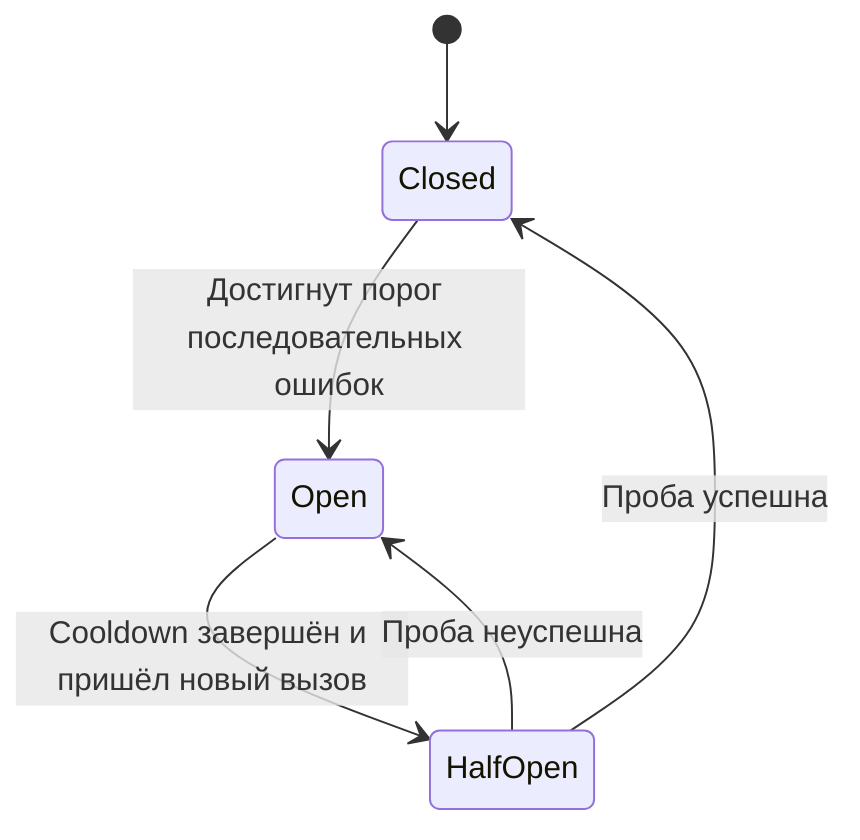

# Retry, exponential backoff и Circuit Breaker

Добавлены **Q225–Q230, C52–C53 и A104–A105** с русскими и английскими текстами. В теории и практике появилась категория **«Отказоустойчивость»**, а в фильтрах — тег `resilience`.

| ID | Формат | Содержание |
|---|---|---|
| Q225 | Вопрос | Расчёт capped full jitter с явно заданной формулой |
| Q226 | Вопрос | Retry-After против оставшегося общего deadline |
| Q227 | Вопрос | Назначение Half-Open |
| Q228 | Вопрос | Sampling window и MinimumThroughput в Polly v8 |
| Q229 | Вопрос | Порядок Retry/Breaker и единица наблюдения |
| Q230 | Вопрос | Почему Open не откатывает уже начатые операции |
| C52 | C# с проверяющим harness | Чистая функция exponential ceiling + cap + jitter, overflow и аргументы |
| C53 | C# с проверяющим harness | Последовательный breaker с управляемыми часами, reset и recovery |
| A104 | Письменное code review | Polly v8: lifetime pipeline, predicate, jitter, timeouts и порядок |
| A105 | Письменный incident/design кейс | Низкий трафик, sample volume, fleet recovery, метрики и fallback |

## Порядок прохождения

C05 → Q225 → C52 → Q226 → Q227 → C53 → Q228–Q230 → A104 → A105. Связанные A60, A90 и C48 полезны для идемпотентности платежа, вложенных retries и тестирования HTTP. C05 по-прежнему не делает задержек: её контракт не изменён.

## Две модели, которые нельзя смешивать

**C52** задаёт собственный full jitter:

`floor(min(capMs, baseDelayMs × 2^(retryNumber−1)) × u)`, где retryNumber начинается с 1, а u передаётся в функцию и лежит в `[0,1)`.

Это позволяет проверить арифметику без сна и статистических assertions. В Polly v8 exponential jitter использует decorrelated formula: C52 не является её побитовой реализацией. Функция сама не повторяет HTTP и не выбирает retryable ошибки; для реального retry loop нужны классификация, безопасность side effect, количество попыток, отменяемое ожидание, Retry-After и суммарный deadline.

**C53** намеренно упрощена: все callback exceptions считаются отказами, учитывается число последовательных сбоев, вызовы синхронные и последовательные. Внедрённые часы не убывают. Thread safety, конкурентное ограничение Half-Open, async cancellation, sampling window и failure ratio не считаются реализованными. Для production классификация ошибок и эти дополнительные свойства требуют отдельного контракта.

В C53 не нужно запускать таймер или background probe: очередной вызов проверяет управляемое время. Отказ в Open не продлевает cooldown. Время открытия отсчитывается от ошибки операции, не от её начала; сравнение elapsed позволяет избежать overflow даты при большом TimeSpan.

## Практические акценты

- Время попыток **и ожиданий** входит в общий budget; повтор не получает новый общий deadline автоматически.
- `MaxRetryAttempts=3` в Polly допускает до четырёх вызовов. Retry на нескольких слоях может перемножить попытки.
- Оборачивающий breaker наблюдает итог retried operation, внутренний — отдельные attempts. Выбор зависит от цели статистики и защиты.
- Pipeline на каждый request не хранит полезную историю между requests. Состояние выбирают по dependency/failure domain, оно не становится fleet-global автоматически.
- Нужны predicate и обработка пользовательской отмены; открытый circuit нельзя слепо повторять как обычный transient failure.
- `MinimumThroughput` — количество исполнений в окне, не максимум RPS. При недостаточном числе samples даже 100% ошибок не обязаны открыть Polly breaker.
- Breaker не заменяет timeout, rate/concurrency limits, идемпотентность или честную семантику fallback. Вымышленный успешный баланс не является безопасной деградацией.

## Проверка и зависимости

Для C52/C53 добавлены отдельные C# harness с детерминированными входами/часами; реальные задержки, сеть и статистические вероятностные проверки не используются. Новых пакетов нет: исполняемые каты используют BCL. Polly-кейс A104 — письменное ревью, библиотека в runner не устанавливалась.

Проведена статическая сверка JSON, ID, RU/EN массивов, связей, переводов результатов и существующего контента. Компиляция, приложение и harness не запускались по инструкции пользователя. Источники и ограничения моделей указаны в карточках.

## Источники

[Microsoft: Retry](https://learn.microsoft.com/en-us/azure/architecture/patterns/retry), [Circuit Breaker](https://learn.microsoft.com/en-us/azure/architecture/patterns/circuit-breaker), [Polly retry](https://www.pollydocs.org/strategies/retry.html), [Polly breaker](https://www.pollydocs.org/strategies/circuit-breaker.html), [Polly pipelines](https://www.pollydocs.org/pipelines/index.html).
